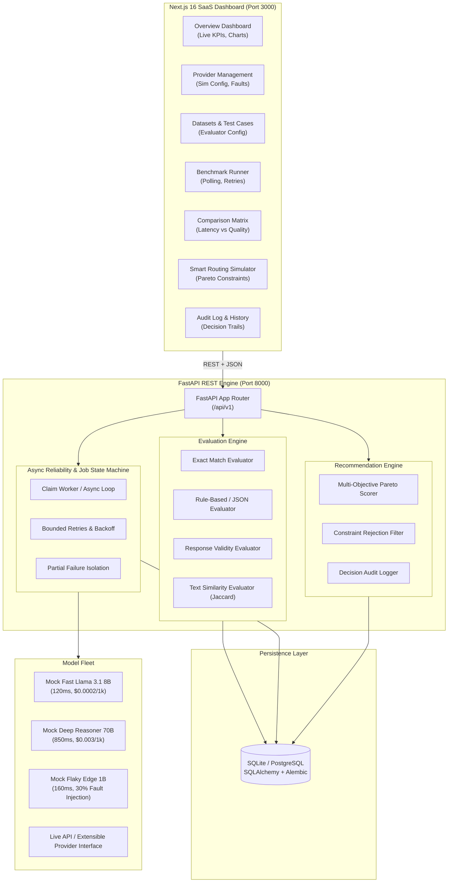

# Edvexa: AI Model Evaluation & Intelligent Routing Platform

[](backend/)
[](frontend/)
[](#system-architecture)
[](LICENSE)

**Edvexa** is an enterprise AI evaluation and model routing platform. It provides automated benchmarking across diverse Large Language Models (LLMs), deterministic evaluations with explicit metric provenance, bounded-retry fault tolerance, and an explainable Pareto-optimal recommendation engine that balances latency, quality, cost, and required capabilities.

---

## System Architecture



---

## Key Platform Capabilities

### 1. Pluggable Evaluation Engine
- **Exact Match Evaluator**: Normalizes whitespace, strips casing, and performs strict or case-insensitive golden output comparisons.
- **Rule-Based Evaluator**: Enforces regex patterns, mandatory substring inclusion, banned tokens, length boundaries, and strict JSON schema validation (with required keys checks).
- **Response Validity Evaluator**: Detects model hallucinations, empty outputs, crash strings, and output truncation.
- **Text Similarity Evaluator**: Normalized token-level Jaccard similarity combined with sequence matching fallback.
- **Normalized Scoring**: All evaluations return normalized scores between `0.0` and `1.0` along with human-readable rationale strings.

### 2. Provider Abstraction & Deterministic Simulation
- Uniform `BaseProvider` interface supporting asynchronous model queries with token accounting and cost calculation.
- Deterministic mock providers for fully offline, reproducible benchmarking:
  - **Mock Fast Llama 3.1 8B**: Fast (~120ms), ultra-low cost ($0.0002/1k tokens), specialist in arithmetic and basic tasks.
  - **Mock Deep Reasoner 70B**: High capacity (~850ms), $0.003/1k tokens, specialist in strict JSON schema generation and reasoning.
  - **Mock Flaky Edge 1B**: Ultra-low cost budget model with configurable simulated transient rate limits (30% failure rate) to test system resilience.

### 3. Distributed Async Reliability & Job Execution
- **State Machine**: Transitions through `QUEUED -> RUNNING -> COMPLETED | FAILED`.
- **Atomic Job Claims**: Transactional row-level claim with heartbeat timestamps to prevent duplicate runs across distributed workers.
- **Bounded Retries**: Differentiates retryable vs non-retryable errors with exponential backoff.
- **Partial Failure Tolerance**: Model failures do not crash benchmark batches; completed results are preserved.
- **Idempotent Retry**: Re-running a failed job only evaluates incomplete or failed requests without duplicating previous work.

### 4. Explainable Multi-Objective Recommendation Engine
- **Routing Strategies**: `balanced` (Pareto composite scoring), `highest_quality`, `lowest_latency`, and `lowest_cost`.
- **Constraint Satisfaction**: Hard filtering for max latency, max budget per query, minimum quality thresholds, and required capability tags.
- **Explainability**: Every routing decision generates an audit record (`RecommendationAudit`) with natural language trade-off explanations and rejection logs for every candidate model.

### 5. Next.js 16 SaaS Dashboard
- Built with **Next.js 16 (Turbopack)**, **Tailwind CSS**, **Lucide Icons**, and **Recharts**.
- Sleek slate/indigo enterprise dark theme.
- 8 dedicated views:
  1. `/` — **Fleet Overview & Analytics** (Live KPIs, error rates, quality vs latency breakdown, model status toggles).
  2. `/providers` — **Provider Management** (Simulation configs, latency budgets, fault injection rates, capability tags).
  3. `/datasets` — **Datasets & Test Cases** (Prompt suite manager, evaluator config JSON editor, test case preview).
  4. `/benchmarks` — **Benchmark Execution** (Launch wizard, worker concurrency, real-time polling progress bar, retry failed).
  5. `/benchmarks/[id]` — **Results Drill-down** (Side-by-side prompt responses, token usage, wall-clock vs simulated latency, evaluator reasons).
  6. `/compare` — **Comparison Matrix** (Scatter charts, latency profiles, cost comparison table).
  7. `/recommendations` — **Smart Routing Simulator** (Interactive sliders, capability filters, winner spotlight, trade-off analysis).
  8. `/history` — **System Audit Trail** (Historical benchmark executions and persistent recommendation decision logs).

---

## Database Schema (Relational Architecture)

The system uses SQLAlchemy ORM with support for both SQLite and PostgreSQL.

| Table Name | Description | Key Columns / Constraints |
|:---|:---|:---|
| `providers` | Model provider registry and simulation configurations | `id` (PK, UUID), `identifier` (Unique), `capabilities` (JSON), `simulated_latency_ms`, `simulated_cost_per_1k_tokens`, `simulated_failure_rate`, `timeout_seconds`, `max_retries`, `is_enabled`, `is_mock` |
| `benchmark_datasets` | Test dataset suites | `id` (PK, UUID), `name`, `version`, `is_seeded`, `created_at` |
| `test_cases` | Deterministic benchmark prompts & scoring rules | `id` (PK, UUID), `dataset_id` (FK -> `benchmark_datasets.id`), `task_type`, `prompt`, `expected_output`, `evaluator_type`, `evaluator_config` (JSON), `weight`, `required_capabilities` (JSON) |
| `benchmark_jobs` | Distributed benchmark execution state machine | `id` (PK, UUID), `dataset_id` (FK), `status` (Enum: `QUEUED`, `RUNNING`, `COMPLETED`, `FAILED`), `worker_id`, `claimed_at`, `heartbeat_at`, `total_requests`, `completed_requests`, `successful_requests`, `failed_requests` |
| `benchmark_results` | Individual evaluation records with provenance | `id` (PK, UUID), `job_id` (FK), `provider_id` (FK), `test_case_id` (FK), `attempt`, `is_success`, `wall_clock_latency_ms`, `simulated_latency_ms`, `quality_score`, `passed`, `cost_provenance`, `evaluation_reason`. **UniqueConstraint:** `(job_id, provider_id, test_case_id, attempt)` |
| `recommendation_audits` | Persistent decision audit trail for model routing | `id` (PK, UUID), `strategy`, `winner_provider_id`, `constraints` (JSON), `weights` (JSON), `explanation`, `trade_offs`, `candidates_evaluated` (JSON), `created_at` |

---

## API Endpoints Reference

The FastAPI backend provides structured REST endpoints under the `/api/v1` prefix:

| Method | Endpoint | Description |
|:---|:---|:---|
| `GET` | `/api/v1/health` | Service health status and version verification |
| `GET` | `/api/v1/ready` | Database readiness check |
| `GET` | `/api/v1/dashboard/overview` | Aggregated fleet KPIs, quality scores, latency, and provider breakdowns |
| `GET` | `/api/v1/providers` | List all registered model providers |
| `POST` | `/api/v1/providers` | Register a new model provider |
| `PUT` | `/api/v1/providers/{id}` | Update simulation parameters, timeouts, and capabilities |
| `POST` | `/api/v1/providers/{id}/toggle` | Quick enable/disable switch for provider availability |
| `GET` | `/api/v1/datasets` | List benchmark datasets with test case counts |
| `POST` | `/api/v1/datasets` | Create a new evaluation dataset |
| `POST` | `/api/v1/datasets/{id}/test-cases` | Add a test case with custom evaluator rules |
| `POST` | `/api/v1/datasets/seed` | Seed standard benchmark dataset and baseline mock models |
| `GET` | `/api/v1/benchmarks` | List benchmark execution jobs with request progress |
| `POST` | `/api/v1/benchmarks` | Launch a new asynchronous benchmark run |
| `GET` | `/api/v1/benchmarks/{id}` | Get benchmark job state and progress counters |
| `GET` | `/api/v1/benchmarks/{id}/results` | Fetch granular results with prompt responses and evaluator reasons |
| `POST` | `/api/v1/benchmarks/{id}/retry` | Idempotently retry failed requests without duplicate evaluations |
| `GET` | `/api/v1/benchmarks/compare/matrix` | Cross-model comparison matrix across quality, latency, and unit cost |
| `POST` | `/api/v1/recommendations` | Compute Pareto-optimal routing with constraint filtering & audit logging |
| `GET` | `/api/v1/recommendations/history` | Retrieve persistent routing decision audit records |

---

## Quickstart & Local Installation

### Prerequisites
- **Python**: 3.10+ (tested on Python 3.13)
- **Node.js**: v20+ (tested on Node v24)
- **npm**: 10+ (tested on npm 11)

### 1. Backend Setup & Startup
```powershell
# Navigate to backend directory
cd backend

# Create and activate Python virtual environment
python -m venv venv
.\venv\Scripts\Activate.ps1

# Install dependencies
pip install -r requirements.txt

# Run database migrations / initialize tables
.\venv\Scripts\python -c "from app.core.database import Base, engine; Base.metadata.create_all(bind=engine)"

# Run automated test suite (20 tests)
.\venv\Scripts\pytest -v

# Start FastAPI development server (Port 8000)
.\venv\Scripts\uvicorn app.main:app --host 0.0.0.0 --port 8000 --reload
```
The interactive OpenAPI Swagger documentation is available at `http://localhost:8000/api/v1/docs`.

### 2. Frontend Setup & Startup
```powershell
# Navigate to frontend directory
cd frontend

# Install dependencies (already prepared)
npm install

# Build production bundle
npm run build

# Start Next.js development server (Port 3000)
npm run dev
```
Open `http://localhost:3000` in your web browser.

---

## Metric Accounting & Provenance Methodology

Edvexa enforces strict provenance tracking across all collected evaluation metrics:
- **Wall-clock Latency**: Measured execution duration from request dispatch to response arrival (`wall_clock_latency_ms`).
- **Simulated Latency**: Injected latency configured on mock providers (`simulated_latency_ms`).
- **Token Accounting**: Prompt tokens, completion tokens, and total token count computed per request.
- **Cost Provenance**:
  - `simulated`: Incurred from deterministic mock pricing models.
  - `estimated`: Derived from published token rates ($ per 1k tokens).
  - `measured`: Read directly from upstream provider billing headers.
  - `unknown`: Fallback when pricing data is unavailable.

---

## Test Suite Coverage

The project includes 20 automated pytest tests covering all critical subsystems:
- `tests/test_api.py`: REST endpoints (health, readiness, providers, datasets, dashboard metrics).
- `tests/test_async_reliability.py`: Atomic job claims, concurrent worker isolation, bounded retries, and partial failure handling.
- `tests/test_evaluators.py`: Exact match, rule-based regex/substring, JSON schema verification, response validity, and text similarity.
- `tests/test_providers.py`: Mock Fast Llama, Mock Deep Reasoner, and simulated transient failure fault injection.
- `tests/test_recommendation_engine.py`: Pareto scoring, constraint rejection filtering, and audit trail persistence.
